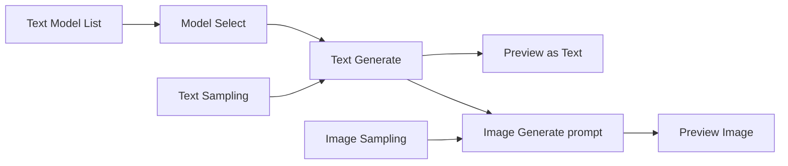

# HordeAI

AI Horde integration as custom node(s) for ComfyUI

This extension provides ComfyUI nodes for generating images and text using the [AI Horde](https://aihorde.net/) distributed network.

## Features

- **AI Horde Image Generate**: Generate images using AI Horde's distributed network
- **AI Horde Image Sampling**: Share immutable sampling settings between image generation nodes
- **AI Horde Model List**: Get list of available models on the network
- **AI Horde Text Generate**: Generate LLM completions as composable text outputs
- **AI Horde Text Model List**: Discover online LLMs, including custom model names
- **AI Horde Text Sampling**: Share sampling settings between text generation nodes
- **AI Horde Model Select**: Select one model from a discovered list without generating once per listed model
- Support for multiple models (Deliberate, Anything Diffusion, AlbedoBase XL, etc.)
- Configurable image dimensions, steps, CFG scale, and more
- Anonymous generation or use your own API key
- Image generation with proper ComfyUI integration
- Support for txt2img, img2img, inpainting, outpainting, and remix modes
- Support for LORA and textual inversion models
- Cancel a queued or running AI Horde generation with ComfyUI's existing cancel control

## Installation

### Option 1: ComfyUI Manager (Recommended)
1. Install [ComfyUI](https://docs.comfy.org/get_started)
2. Install [ComfyUI-Manager](https://github.com/ltdrdata/ComfyUI-Manager)
3. Look up "HordeAI" in ComfyUI-Manager and install it
4. Restart ComfyUI

### Option 2: Manual Installation
1. Clone this repository into your `ComfyUI/custom_nodes` directory:
   ```bash
   cd ComfyUI/custom_nodes
   git clone https://github.com/malte0621/hordeai-comfy.git
   ```
2. Install dependencies:
   ```bash
   cd hordeai-comfy
   pip install -r requirements.txt
   ```
3. Restart ComfyUI

## Usage

### AI Horde Image Generate Node

This node generates images using the AI Horde network:

**Required Inputs:**
- `prompt`: Text description of the image to generate
- `width`: Image width (64-2048, step 64)
- `height`: Image height (64-2048, step 64) 
- `num_images`: Number of images to generate (1-4)

**Optional Inputs:**
- `model`: Optional exact model name. Leave blank or omit the input to use any compatible online image model.
- `negative_prompt`: Text describing what to avoid in the image
- `api_key`: Your AI Horde API key (leave empty for anonymous)
- `sampling`: Optional `HORDE_IMAGE_SAMPLING` connection from **AI Horde Image Sampling**. Unconnected uses standard defaults.
- `source_image`: Input image for img2img or inpainting (ComfyUI tensor)
- `source_processing`: "txt2img", "img2img", "inpainting", "outpainting", or "remix" (default "txt2img")
- `loras`: List of LORA model names to apply
- `textual_inversions`: List of textual inversion names to apply

**Output:**
- `images`: Generated images as ComfyUI tensors

### AI Horde Image Sampling Node

Find this node under **AI Horde/Image**. Connect its `sampling` output to one or more **AI Horde Image Generate** nodes. Dimensions, prompts, model selection, source images, masks, and adapters remain on the generation node.

| Input | Meaning |
|---|---|
| `steps` | Sampling steps; default 20, range 1–100. |
| `cfg_scale` | Classifier-free guidance scale; default 7.5, range 1.0–20.0. |
| `seed` | Default -1 requests a random seed. Explicit seeds range from 0 to 2147483647. |
| `denoising_strength` | Source-image denoising strength; default 1.0, range 0.0–1.0. Plain txt2img always uses 1.0. |
| `sampler_name` | Sampling algorithm; default `k_lms`. Existing sampler choices are retained. |
| `karras` | Use the Karras noise schedule where supported; default `True`. |

One connected sampling node shares these values across generation branches without sharing dimensions, source processing, or adapter lists. Omitting the connection preserves the defaults above.

**Existing workflows:** move the six sampling values into an **AI Horde Image Sampling** node. Recreate the **AI Horde Image Generate** node and reconnect its remaining inputs, then connect `sampling`. The old generation node's sampling widgets and API arguments have been removed; old positional widget layouts must not be reused.


### AI Horde Text Generate Node

Find this node under **AI Horde/Text**. Only `prompt` is required. Connect `text` to **Preview as Text**, a string-processing node, or an image-generation prompt.

| Input | Meaning |
|---|---|
| `prompt` | Completion prompt, sent unchanged. Include the selected LLM's instruction format when needed. |
| `model` | Optional exact Horde model name, including prefixes such as `koboldcpp/`. Blank or omitted accepts any LLM. |
| `api_key` | Optional Horde API key. Blank uses anonymous generation. |
| `max_length` | Maximum output tokens per completion; default 256, range 16–16384. |
| `max_context_length` | Prompt plus output token budget; default 2048, range 80–1048576. Must exceed `max_length`. |
| `num_texts` | Number of completions; default 1, range 1–20. |
| `context_fit` | `reject` refuses oversized prompts; `ignore` lets workers truncate; `grow` increases context and may cost more kudos. Default: `reject`. |
| `sampling` | Optional `HORDE_TEXT_SAMPLING` connection from **AI Horde Text Sampling**. |

Outputs are aligned ComfyUI lists: `text` (`STRING`), the actual `model` (`STRING`), and the returned `seed` (`INT`). With one completion, each list contains one value. With multiple completions, downstream nodes normally execute once per value. No partial text is returned after cancellation or a failed batch.

### Sampling and Model Selection

**AI Horde Text Sampling** exposes `temperature`, `top_p`, `top_k`, `min_p`, `repetition_penalty`, and optional `stop_sequences`. Connect one sampling output to several generation nodes to share settings. Enter one exact stop sequence per line; empty lines are ignored and spaces are preserved. AI Horde may include the stop sequence in returned text.

**AI Horde Text Model List** returns currently online LLM names alphabetically. Its optional `top_n` limits the result to 1–1000 names, default 100. **AI Horde Model Select** consumes an entire image or text model list and returns the zero-based `index` as one model string. An unconnected selector returns a blank model; an empty connected list or invalid index reports an error.

### Composing Workflows



- Categories separate **AI Horde/Image**, **AI Horde/Text**, **AI Horde/Adapters**, and **AI Horde/Workflow**.
- Convert a `model` or `api_key` widget to an input to share values across generation nodes.
- Chain **AI Horde LoRA** or **AI Horde Textual Inversion** nodes through their list inputs. Branches do not mutate a shared input list.
- Existing node identifiers and output types remain unchanged. Image `model` is now optional, so saved explicit-model connections still work.
- A blank image model resolves online model names and filters incompatible source/sampler requirements. This avoids Horde's `models=[]` image default, which does not mean unrestricted models. Explicit model names skip discovery.


### Cancelling a Generation

Click **Cancel current run** in ComfyUI while an image or text generation node is running. The extension stops waiting or downloading, sends AI Horde a cancellation request for that generation ID, and reports a normal ComfyUI interruption instead of returning partial results.

The extension checks for interruption every 0.1 seconds while waiting. If submission is already in flight, it first waits for the server to return the generation ID so it can cancel the remote request. Submission and cancellation each have a 30-second HTTP timeout. If remote cancellation fails, the log includes the generation ID; remote work may continue. Workers already processing an image may finish that work even after the request is cancelled.

### AI Horde Model List Node

This node lists available models on the AI Horde network:

**Optional Inputs:**
- `top_n`: Number of models to return, ranked by monthly usage (1-100, default 20)

**Output:**
- `model_list`: A ComfyUI list of image model names. Connect it to **AI Horde Model Select** to choose one.

### Image Payload Validation

Plain txt2img requests omit `source_processing`, `source_image`, and `source_mask` from the API payload. AI Horde rejects an explicitly supplied `source_processing="txt2img"`; the field accepts only source-image processing modes. If a non-txt2img mode has no source image, the extension warns and sends a plain txt2img request instead.

## API Key

While you can use AI Horde anonymously, having an API key provides benefits:
- Higher priority in the generation queue
- Access to more models
- Faster generation times

Get your free API key at [AI Horde](https://aihorde.net/).

## Requirements

- Python 3.12+ (required by the current upstream SDK)
- ComfyUI with async custom-node support
- horde-sdk>=0.33.3,<0.34
- aiohttp>=3.11.13
- Pillow>=11.1.0
- numpy>=1.24.0
- torch>=2.0.0
- loguru>=0.7.3

This extension targets upstream [horde-sdk v0.33.3](https://github.com/Haidra-Org/horde-sdk/releases/tag/v0.33.3). The upper bound avoids installing an unverified minor SDK API change. When updating an existing installation, use ComfyUI's Python environment to run `python -m pip install --upgrade -r requirements.txt`, then restart ComfyUI. Upgrade Python first if that environment is older than 3.12.

## Develop

To install the dev dependencies and pre-commit (will run the ruff hook), do:

```bash
cd hordeai-comfy
pip install -e .[dev]
pre-commit install
```

The `-e` flag above will result in a "live" install, in the sense that any changes you make to your node extension will automatically be picked up the next time you run ComfyUI.

### Source Layout

```text
__init__.py                       ComfyUI extension entry point
src/hordeai/
    registry.py                   Stable node identifiers and display names
    nodes/
        image/                    Image generation, reusable sampling, and model-list nodes
        text/                     LLM generation, sampling, and online model-list nodes
        adapters/                 Separate LoRA and textual inversion modules
        model_select.py           Whole-list model selection for workflows
        inputs.py                 Shared model and API-key widget specifications
    generation/request.py         Typed image settings and SDK request construction
    generation/image.py           Immutable image sampling settings and payload construction
    generation/text.py            Typed LLM generation and sampling settings
    services/horde.py             Image/text SDK operations and model discovery
    services/lifecycle.py         Shared polling, interrupted submission, and remote cleanup
    services/model_selection.py   Compatible online image-model resolution
    utils/images.py               Tensor, PIL, and base64 WebP conversion
```

Nodes own ComfyUI inputs and outputs. Generation settings own request construction. `HordeClient` owns HTTP sessions; `GenerationSession` owns each remote job and its cancellation lifecycle. Imports use the installed `hordeai` package or package-relative paths when ComfyUI loads the extension directly.

## Publish to Github

Install Github Desktop or follow these [instructions](https://docs.github.com/en/authentication/connecting-to-github-with-ssh/generating-a-new-ssh-key-and-adding-it-to-the-ssh-agent) for ssh.

1. Create a Github repository that matches the directory name. 
2. Push the files to Git
```
git add .
git commit -m "project scaffolding"
git push
``` 

## Writing custom nodes

The image and text generation custom nodes are located in [image/generate.py](src/hordeai/nodes/image/generate.py) and [text/generate.py](src/hordeai/nodes/text/generate.py). To learn more, read the [docs](https://docs.comfy.org/essentials/custom_node_overview).


## Tests

The Pytest suite exercises the real upstream SDK against an isolated local HTTP server. It covers image/text cancellation during submission and polling, image downloads, cleanup failures, successful generation, workflow list composition, omitted-model selection, serialized txt2img payloads, reusable sampling, and image conversion. Tests require no API key, public AI Horde workers, or ComfyUI installation.

- [build-pipeline.yml](.github/workflows/build-pipeline.yml) will run pytest and linter on any open PRs
- [validate.yml](.github/workflows/validate.yml) will run [node-diff](https://github.com/Comfy-Org/node-diff) to check for breaking changes

```bash
python -m pytest tests
ruff check src/hordeai tests __init__.py
```

## Publishing to Registry

If you wish to share this custom node with others in the community, you can publish it to the registry. We've already auto-populated some fields in `pyproject.toml` under `tool.comfy`, but please double-check that they are correct.

You need to make an account on https://registry.comfy.org and create an API key token.

- [ ] Go to the [registry](https://registry.comfy.org). Login and create a publisher id (everything after the `@` sign on your registry profile). 
- [ ] Add the publisher id into the pyproject.toml file.
- [ ] Create an api key on the Registry for publishing from Github. [Instructions](https://docs.comfy.org/registry/publishing#create-an-api-key-for-publishing).
- [ ] Add it to your Github Repository Secrets as `REGISTRY_ACCESS_TOKEN`.

A Github action will run on every git push. You can also run the Github action manually. Full instructions [here](https://docs.comfy.org/registry/publishing).

